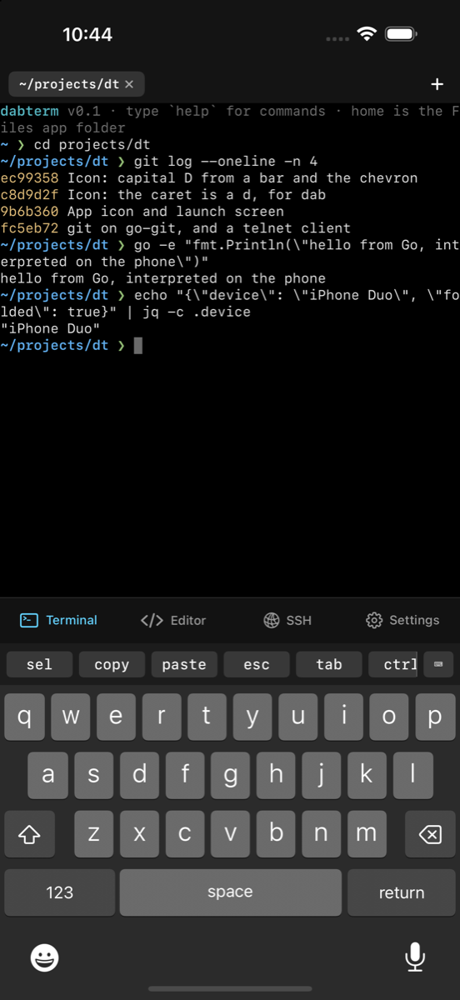
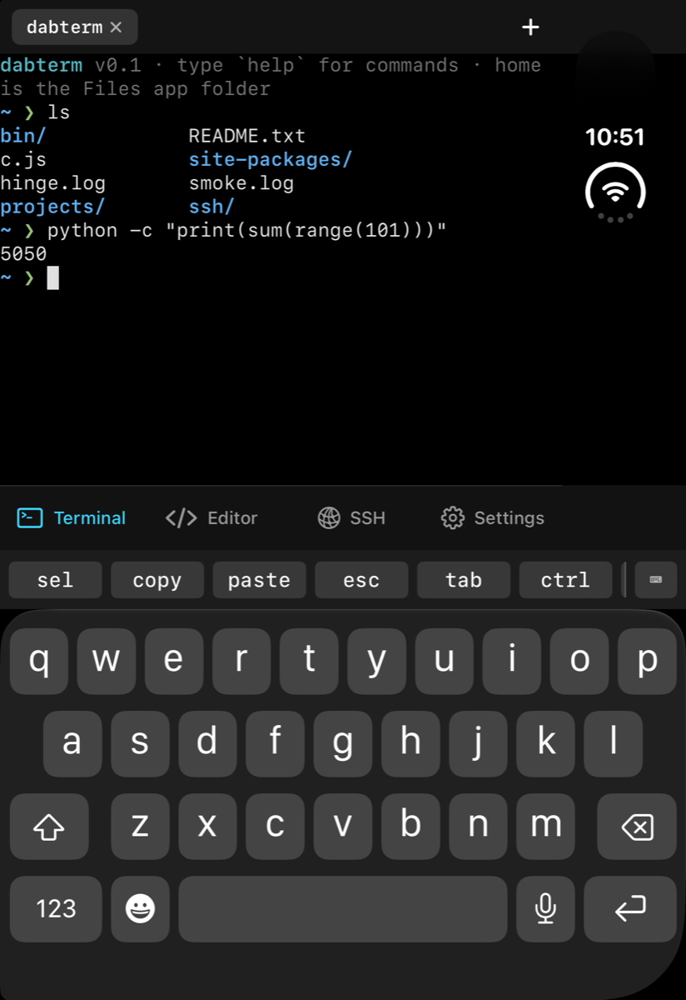
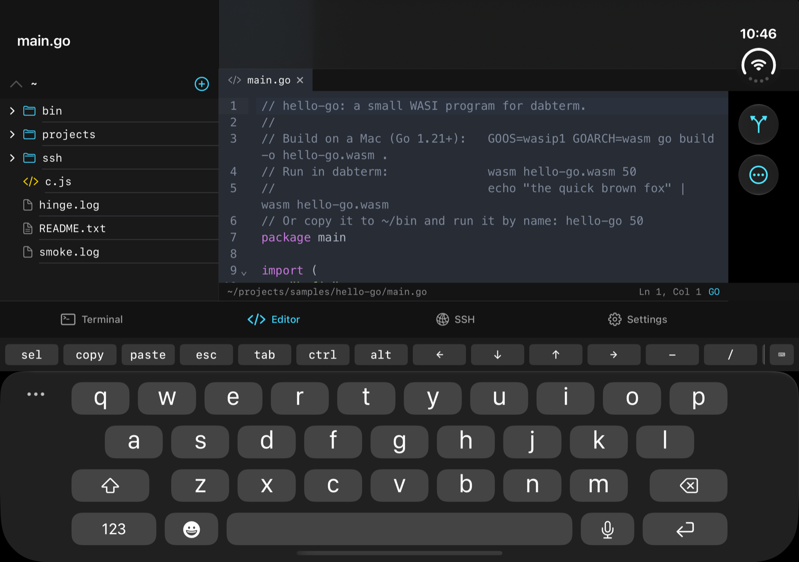
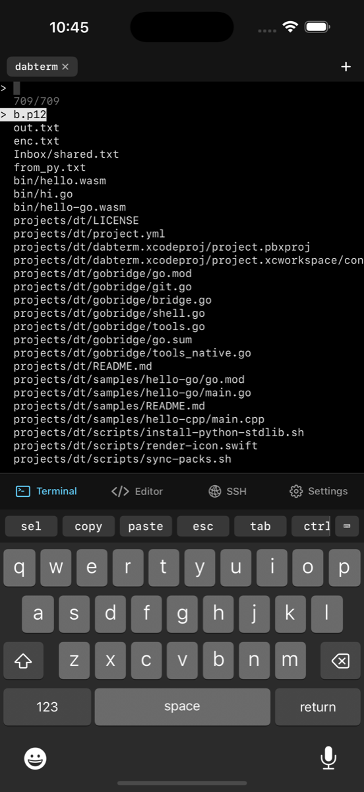
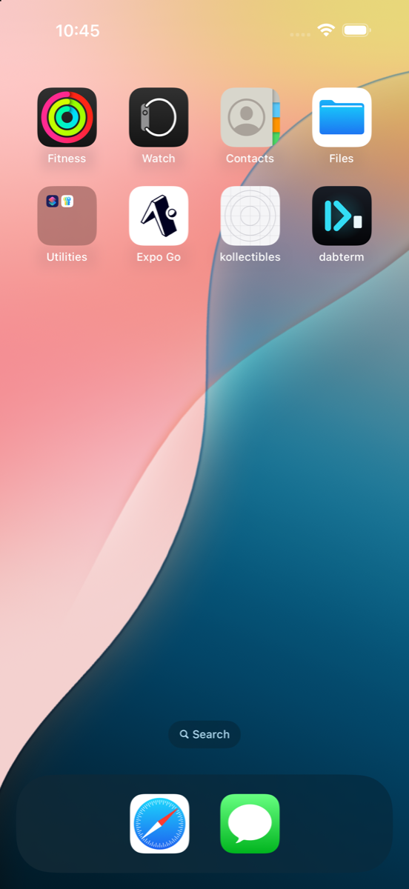

# A terminal for the phone I actually have in my hand

I have a toddler. If you have one too you already know the shape of my day: nothing happens in
blocks longer than about four minutes. I sit down, I get up. Something is being climbed, something
is being eaten that should not be eaten, somebody needs a hand getting down from the thing they
just got up onto. Then I sit down again.

A laptop does not survive that. Opening it is a commitment: find a flat surface, wake it, log in,
find the window I was in, and by the time I am oriented I am standing up again, and the laptop is
sitting open on the couch at toddler height. Closing it every time means I never really start.
Even with vibe coding, where most of my "typing" is a sentence to an agent and the rest is
reading what came back, the laptop is the wrong object. The work is small and bursty. The device
should be too.

The other half of it is harder to admit. A laptop screen is a wall. When it is open in front of
me I am behind it, and my kid can see that I am behind it. A phone I can hold at waist height,
glance at, pocket, pull back out. I can be in the room. Half-open on the table, the top half is a
screen and the bottom half is a keyboard, and it folds shut in one motion when a small person
wanders over to see what is interesting. That is the posture I wanted to build around.

## Why a foldable

The iPhone Duo gives you three devices. Closed, it is a normal phone with a tall narrow screen.
Fully open, it is a small tablet. Half-open, it becomes a laptop the size of a paperback: upper
half for content, lower half for the keyboard, hinge as the fold of a book.

That last one is the whole reason this project exists. A terminal on a slab phone is a cramped
thing where the keyboard eats the screen. A terminal on the half-open Duo is a tiny laptop that
closes with a flick, and nobody has to clear the table for it.

## What dabterm is

dabterm is a terminal and editor for iOS that keeps everything inside the app's own folder, the
one you can see in the Files app. There is no server, no account, no sync service: a shell, a
code editor, SSH, git, and a set of language runtimes, running on the phone.

The constraint that shapes all of it is Apple's: an iOS app cannot start other processes and
cannot run code it just generated. There is no `fork`, no `exec`, no JIT. So every "program" in
dabterm is either built into the app as a library or runs on an interpreter. That turns out to be
a surprisingly good set of tools once you lean into it.

**Shell.** A built-in shell with pipes, redirects, variables, history, tab completion and scripts
in `~/bin`. If you want more, `chsh bash` switches to a bash-syntax shell, compiled in from a
pure-Go implementation: functions, loops, `$(...)`, heredocs, globbing, arrays. Shells are
pluggable, so a shell that is not in a given build simply is not offered.

**Languages.** Python 3.13 is the real CPython with its full standard library, plus a `pip` that
installs pure-Python packages from PyPI. Go runs through Yaegi, a Go interpreter written in Go
that is built into the app, so `go run main.go` works on the phone with the standard library
compiled in. JavaScript runs on the system engine. Anything compiled to WebAssembly runs on a
WASI interpreter, which is the path for C, C++ and Rust: build on a Mac, drop the `.wasm` in
`~/bin`, run it by name.

**Tools.** The ones you reach for without thinking: `awk`, `jq`, `yq`, `grep`, `sed`, `fzf`,
`less`, `xargs`, `patch`, `tar`, `zip`, `sqlite3`, `curl`, `dig`, `ping`, `ssh`, `scp`,
`telnet`. Ctrl-R is fuzzy history search.

**git.** Real git on go-git: repositories with history in `.git`, local commits, branches, diffs,
fetch, pull, push. GitHub logs in with a device code, so there is no pasting of tokens, and the
app installs on the account like any GitHub App.

**Editor.** CodeMirror in a web view, with a file tree beside it on the wide screen, syntax
highlighting for the usual languages, search, and a key bar above the keyboard for the keys iOS
does not have: Esc, Tab, Ctrl, Alt, arrows, and the symbols a shell needs.

## The fold was the hard part

Getting the layout right on the half-open phone took longer than any language runtime. iOS does
real work for you here: it keeps the keyboard in the lower half and leaves the fold empty. But
every assumption I carried from flat phones was wrong in some small way, and a few of them
compounded.

The keyboard frame iOS reports while bent is not where the keys are. It starts above the fold and
includes the empty band over the hinge, because that is where the keyboard's accessory view goes.
SwiftUI applies its own keyboard avoidance on top of yours unless you turn it off at the hosting
controller, not just ignore it in the view tree. At the end of a fold-to-flat transition, iOS
sends one last keyboard notification with the stale bent frame, so the only reliable source of
truth is to measure, after things settle, where the accessory view actually landed on screen.

I tried a custom soft keyboard in the lower half first, the way a laptop would have it. It looked
right and typed wrong: tapping into the editor to place the caret stopped working, because the
web view was no longer first responder. The system keyboard won. What remains of that idea is
the key bar, which floats into the free space under the fold while bent so that Esc and Tab sit
right above the keys, where your thumbs already are.

Apple's own guidance for the Duo, which I should have read first, says most of this in two
pages: lay out from your view's bounds, never from the screen; ask the reserved-region API where
the fold is instead of inferring it from the hinge angle; let system containers adapt themselves.

## What it is not

It is not a replacement for the laptop when I have an hour. It is a replacement for the laptop
in the ninety-second gaps, which, added up across a day with a toddler, are most of the day. Pull
a repo, read a diff, fix the thing, run it, push, fold the phone, pick up the kid. The laptop
stays shut, and I am still in the room.

The code is at github.com/dabbers/dabterm. It is MIT, and most of it was written the way I
described above: a sentence to an agent in a gap, a look at the result in the next one.
